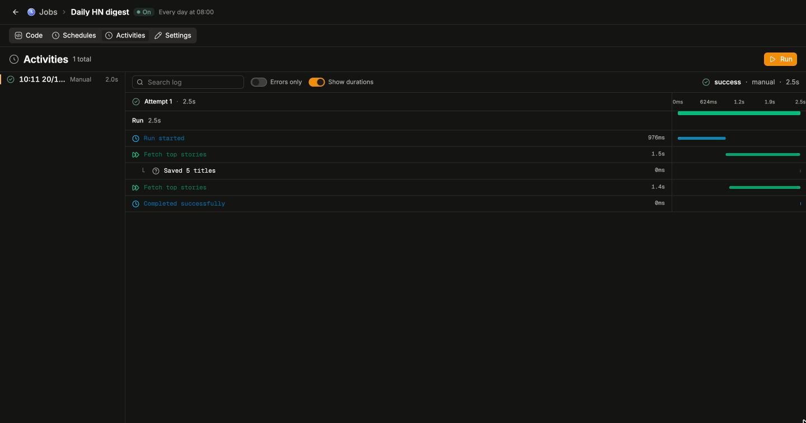

<p align="center">
  
</p>

<h1 align="center">Open Agent Hands</h1>

<p align="center">
  <strong>The hands your AI agents build with.</strong><br />
  A local app where Claude Code and Codex create and run tools, MCP servers, sites, jobs and data over MCP, while you watch.
</p>

<p align="center">
  <a href="https://github.com/devnonla/open-agent-hands/releases/latest"></a>
  <a href="https://github.com/devnonla/open-agent-hands/actions/workflows/ci.yml"></a>
  
  <a href="LICENSE"></a>
</p>

<p align="center">
  <a href="#install">Install</a> ·
  <a href="#connect-your-agent">Connect your agent</a> ·
  <a href="#day-to-day">Day to day</a> ·
  <a href="#update-and-uninstall">Update</a> ·
  <a href="#troubleshooting">Troubleshooting</a> ·
  <a href="CONTRIBUTING.md">Develop</a>
</p>

<p align="center">
  
</p>

---

## Why

Coding agents are great at writing code, but they have nowhere to *keep* what they build. Open Agent Hands gives them a place to work:

- **Agents do the work.** Over one MCP connection, Claude Code or Codex can write a tool, test it, publish it as its own MCP server, schedule a job, store data or ship a small site.
- **You watch and correct.** The app is for seeing what agents built, reading code and logs, pausing a job or fixing a row. You don't build things in it.
- **It runs on your machine.** It's one app with a local SQLite database. There's no cloud and no account to sign up for. To run it on a server instead, see [Run on a server with Docker](#run-on-a-server-with-docker).

<p align="center">
  
</p>

## Install

```bash
curl -fsSL https://github.com/devnonla/open-agent-hands/releases/latest/download/install.sh | sh
```

- **macOS:** installs **Open Agent Hands.app** into `/Applications` and opens it. The app sits in the menu bar and runs the server for you. It also adds the `agenthands` command to your terminal.
- **Linux:** installs the `agenthands` binary into `~/.local/bin`. Start it with `agenthands`.

Then open **http://127.0.0.1:8429**, create your account and pick a workspace. Everything stays on your machine.

## Connect your agent

1. In the app, open **MCP Servers**.
2. Copy the command from the **Core MCP** card and run it in a terminal:

   ```bash
   claude mcp add --transport http agenthands http://127.0.0.1:8429/mcp/core --scope user \
     --header "Authorization: Bearer <core-key>"
   ```

3. Ask your agent for something, for example:

   > Create a tool that fetches YouTube transcripts and put it on a new MCP server called "Research kit".

The agent reads the built-in guide, writes the tool, runs it until it works and publishes it. You see each step appear in the app.

To use those tools from **another** client (Cursor, Claude Desktop, another agent), click **Connect** on the server card. You get the URL, a private token and a ready-to-paste config. Each server exposes only the tools assigned to it.

## Day to day

Agents create things. You mostly look, and step in when needed.

| Area | What you do here |
| --- | --- |
| **MCP Servers** | Copy connect info, turn a server on or off, rotate its token |
| **Tools** | Read and fix code, group tools into folders |
| **Jobs** | See the schedule in plain words and the next runs, pause or resume, run now, read the logs |
| **Sites** | Preview, publish, set a password |
| **Datatables** | Browse and edit rows |
| **KV Store / Secrets** | Enter values that agents should use but never see in chat, such as API keys |
| **Workspaces** | Keep clients or projects apart. Each has its own tools, data and keys |

Things you might ask an agent:

- *"Every weekday at 8am, save the top Hacker News stories to a datatable."*
- *"Make a small site that lists my leads from the crm datatable, with a password."*
- *"Add a tool that converts text to a URL slug and put it on the Everyday server."*

<details>
<summary><b>Everything the Core MCP can do</b> (49 tools)</summary>

| Group | Tools |
| --- | --- |
| Guide | `get_guide` |
| Workspaces | `list_workspaces` `create_workspace` `update_workspace` `delete_workspace` |
| Tools | `list_tools` `get_tool` `create_tool` `update_tool` `run_tool` `delete_tool` |
| MCP servers | `list_mcp_servers` `create_mcp_server` `update_mcp_server` `add_tools_to_mcp_server` `remove_tools_from_mcp_server` `delete_mcp_server` |
| KV & secrets | `kv_list` `kv_get` `kv_set` `kv_delete` `secret_list` `secret_set` `secret_delete` |
| Datatables | `datatable_list_projects` `datatable_create_project` `datatable_get_schema` `datatable_create_table` `datatable_add_column` `datatable_query` `datatable_insert_rows` `datatable_update_row` `datatable_delete_rows` `datatable_delete_project` |
| Sites | `list_sites` `create_site` `get_site_files` `write_site_file` `preview_site` `approve_site` `publish_site` `delete_site` |
| Jobs | `list_jobs` `get_job` `create_job` `update_job` `run_job` `get_job_runs` `delete_job` |

Every tool takes an optional `workspace` (id or name). The code agents write uses a small runtime SDK:

```ts
import agenthands from "@agenthands/runtime";

const city = await agenthands.kv.get("DEFAULT_CITY", "Hanoi");
const token = await agenthands.secrets.get("OPENWEATHER_API_KEY");
const leads = await agenthands.datatable.query("crm", "leads", { where: { score: { $gt: 80 } } });
```

</details>

## A look inside

<table>
  <tr>
    <td width="50%"><br /><sub><b>Tools</b>: TypeScript with <code>@param</code> annotations. npm imports install automatically.</sub></td>
    <td width="50%"><br /><sub><b>Jobs</b>: scheduled scripts with step timings and logs.</sub></td>
  </tr>
  <tr>
    <td width="50%"><br /><sub><b>Datatables</b>: typed tables that agents and people both read and write.</sub></td>
    <td width="50%"><br /><sub><b>Sites</b>: small React apps with a backend, published at <code>/public/sites/&lt;slug&gt;</code>.</sub></td>
  </tr>
</table>

<p align="center">
  <br />
  <sub><b>Workspaces</b> keep clients and projects apart: tools, data, keys and files all live inside one.</sub>
</p>

## The Mac app

The app is a thin shell around the same server:

- The menu bar icon has **Open**, **Open in Browser**, **Start at Login** and **Quit**.
- Closing the window keeps the server running, so your agents can still connect. **Quit** stops it.
- If the server is already running (for example, started from a terminal), the app uses that one.

## Run from the terminal

On Linux, or on macOS without the app:

```bash
agenthands                       # http://127.0.0.1:8429
agenthands --port 9000           # another port
agenthands --data-dir ~/work-ah  # a separate set of data
```

| Option | Default |
| --- | --- |
| `-p, --port` | `8429` (env `PORT`) |
| `-H, --host` | `127.0.0.1` (env `HOST`) |
| `-d, --data-dir` | `~/.open-agent-hands` (env `DATA_DIR`) |

## Run on a server with Docker

Build and run it on a VPS. Data lives in the `agenthands-data` volume.

```bash
git clone https://github.com/devnonla/open-agent-hands.git
cd open-agent-hands
docker compose up -d --build
```

The port is bound to `127.0.0.1:8429`, so put a reverse proxy with HTTPS in front. With Caddy:

```
agenthands.example.com {
  reverse_proxy 127.0.0.1:8429
}
```

- **Create your account right away.** The first visit to `/setup` creates the only account, and it has full access. Do this before anyone else finds the URL.
- **Sandbox.** Tools and jobs run in bubblewrap, which Docker's default seccomp profile blocks. The compose file sets `seccomp:unconfined` for that reason. Without it, they run unsandboxed.
- **Connect your agent** to `https://agenthands.example.com/mcp/core` with the key from the app, as in "Connect your agent".

## Your data

Everything lives in `~/.open-agent-hands`:

```
data.db               all workspaces, tools, jobs, KV, secrets and datatables (SQLite)
workspaces/<id>/      site files and generated tool folders
logs/server.log       server log when started by the Mac app
```

- **Back up:** quit the app, then copy the whole folder.
- **Secrets:** encrypted at rest.
- **Sandbox:** tools and site backends can run in an OS sandbox (Seatbelt on macOS, bubblewrap on Linux). Turn it on in **Settings → Sandbox**.

## Update and uninstall

**Update:** run the install command again. On macOS it quits the app, replaces it and opens the new version. Your data stays.

**Uninstall:**

1. **macOS:** turn off **Start at Login** in the menu bar, quit the app, and delete `/Applications/Open Agent Hands.app`.
2. **macOS and Linux:** remove the command line link or binary with `rm ~/.local/bin/agenthands`.
3. **Only if you also want to delete all your data:** `rm -rf ~/.open-agent-hands`. This cannot be undone.

## Troubleshooting

<details>
<summary><b>macOS says the app is damaged or from an unidentified developer</b></summary>

The app is not notarized by Apple. The install command clears the download flag for you. If you downloaded the app in a browser instead, run:

```bash
xattr -dr com.apple.quarantine "/Applications/Open Agent Hands.app"
```

</details>

<details>
<summary><b>"Port 8429 is used by another app"</b></summary>

Something else is listening on 8429. Find it with `lsof -nP -iTCP:8429 -sTCP:LISTEN`, stop it, then reopen the app. Or run the server on another port with `agenthands --port 9000`.

</details>

<details>
<summary><b>My agent can't connect</b></summary>

- Check that the app (or `agenthands`) is running: open http://127.0.0.1:8429.
- Copy the command again from the **Core MCP** card. If you rotated the key, the old one stops working.
- For a hosted server, check it is turned **on** and use its own token from **Connect**.

</details>

<details>
<summary><b>Where are the logs?</b></summary>

If the Mac app started the server, logs are in `~/.open-agent-hands/logs/server.log`. If you ran `agenthands` yourself, they are in that terminal. Job and tool run logs are in the app, under each job or tool.

</details>

Still stuck? [Open an issue](https://github.com/devnonla/open-agent-hands/issues/new?template=01-bug.yml).

## Contributing

Want to change Open Agent Hands itself, or run your own fork? See [CONTRIBUTING.md](CONTRIBUTING.md).

## License

[MIT](LICENSE)
