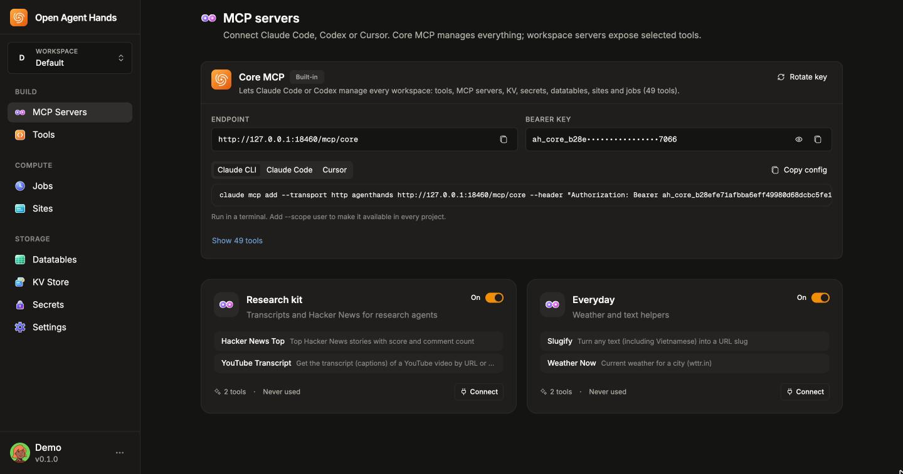
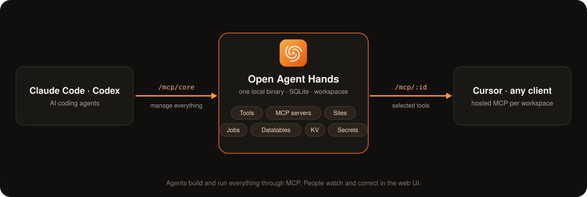
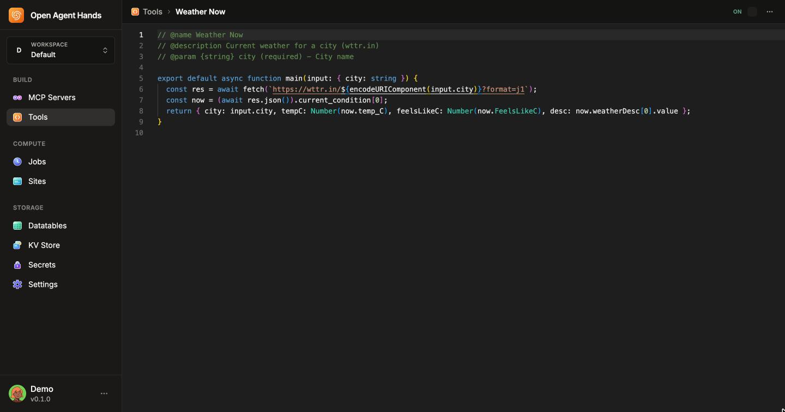
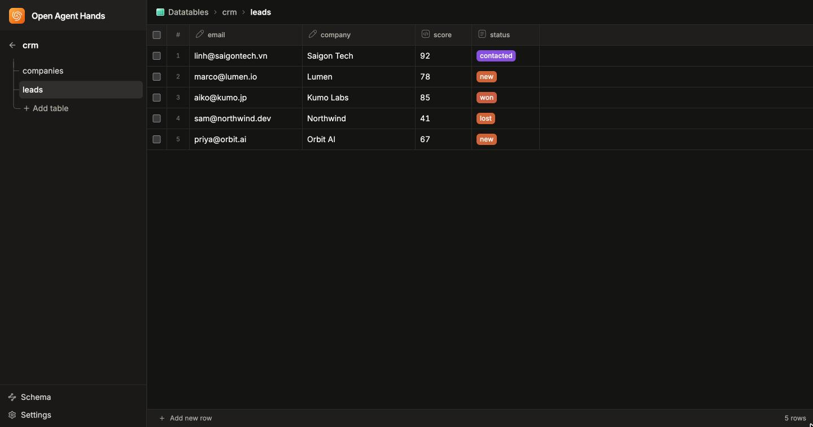
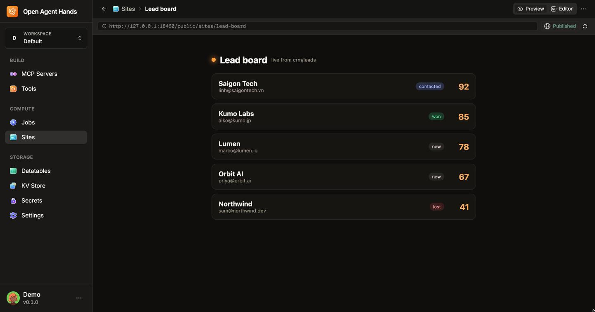
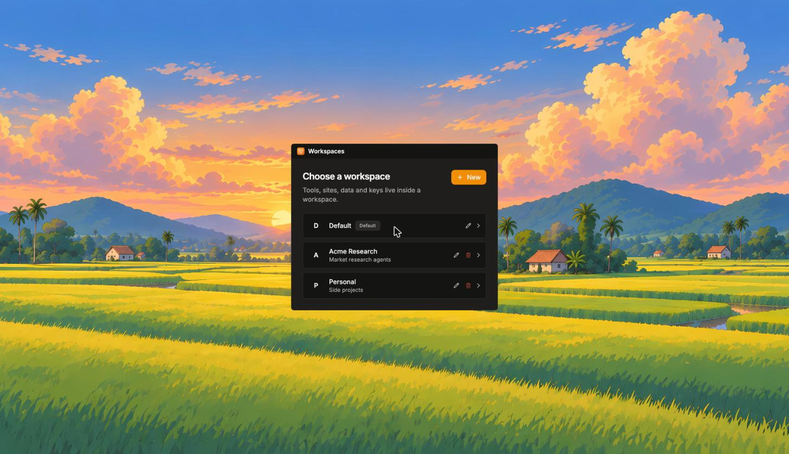

<p align="center">
  
</p>

<h1 align="center">Open Agent Hands</h1>

<p align="center">
  <strong>The hands your AI agents build with.</strong><br />
  A local, single-binary server where Claude Code and Codex create and run tools, MCP servers, sites, jobs and data over MCP, while people mostly watch.
</p>

<p align="center">
  <a href="https://github.com/devnonla/open-agent-hands/releases/latest"></a>
  <a href="https://github.com/devnonla/open-agent-hands/actions/workflows/ci.yml"></a>
  
  <a href="LICENSE"></a>
</p>

<p align="center">
  
</p>

---

## Why

Coding agents are great at writing code, but they have nowhere to *keep* what they build. Open Agent Hands gives them a place to work:

- **Agents do the work.** Over one MCP connection, Claude Code or Codex can write a tool, test it, publish it as its own MCP server, schedule a job, store data or ship a small site.
- **People watch and correct.** The web UI is for watching what agents built, reviewing code and logs, and fixing things by hand. It is not where you build.
- **It runs on your machine.** One binary with SQLite. No Docker, no cloud and no database server.

<p align="center">
  
</p>

## Install

```bash
curl -fsSL https://github.com/devnonla/open-agent-hands/releases/latest/download/install.sh | sh
agenthands
```

Open http://127.0.0.1:8429, create your account and pick a workspace.

```
agenthands [-p|--port 8429] [-H|--host 127.0.0.1] [-d|--data-dir ~/.open-agent-hands]
```

`install.sh` reads these environment variables: `AGENTHANDS_VERSION` (for example `v0.1.0`, default `latest`), `AGENTHANDS_INSTALL_DIR` (default `~/.local/bin`) and `AGENTHANDS_REPO`.

## Connect your agent

Open **MCP Servers** in the UI and copy the command from the **Core MCP** card:

```bash
claude mcp add --transport http agenthands http://127.0.0.1:8429/mcp/core --scope user \
  --header "Authorization: Bearer <core-key>"
```

Then ask your agent something like *"create a tool that fetches YouTube transcripts and expose it on a new MCP server"*. It reads the built-in guide (`get_guide`), writes the code, runs it with `run_tool` until it works, and publishes it.

Each **hosted MCP server** (`/mcp/<id>`) exposes only the tools you assign and has its own token. Use these to plug a narrow set of tools into Cursor, Claude or any other MCP client. Click **Connect** on a server card to get the URL, token and client config.

## What agents can do

The Core MCP has 49 tools in these groups. Every tool takes an optional `workspace` argument (id or name).

| Group | Tools |
| --- | --- |
| Guide | `get_guide` |
| Workspaces | `list_workspaces` `create_workspace` `update_workspace` `delete_workspace` |
| Tools | `list_tools` `get_tool` `create_tool` `update_tool` `run_tool` `delete_tool` |
| MCP servers | `list_mcp_servers` `create_mcp_server` `update_mcp_server` `add_tools_to_mcp_server` `remove_tools_from_mcp_server` `delete_mcp_server` |
| KV & secrets | `kv_list` `kv_get` `kv_set` `kv_delete` `secret_list` `secret_set` `secret_delete` |
| Datatables | `datatable_list_projects` `datatable_create_project` `datatable_get_schema` `datatable_create_table` `datatable_add_column` `datatable_query` `datatable_insert_rows` `datatable_update_row` `datatable_delete_rows` `datatable_delete_project` |
| Sites | `list_sites` `create_site` `get_site_files` `write_site_file` `preview_site` `approve_site` `publish_site` `delete_site` |
| Jobs | `list_jobs` `get_job` `create_job` `update_job` `run_job` `get_job_runs` `delete_job` |

Tools, jobs and site backends share a small runtime SDK:

```ts
import agenthands from "@agenthands/runtime";

const city = await agenthands.kv.get("DEFAULT_CITY", "Hanoi");
const token = await agenthands.secrets.get("OPENWEATHER_API_KEY");
const leads = await agenthands.datatable.query("crm", "leads", { where: { score: { $gt: 80 } } });
```

## A look inside

<table>
  <tr>
    <td width="50%"><br /><sub><b>Tools</b>: TypeScript with <code>@param</code> annotations. npm imports install automatically.</sub></td>
    <td width="50%"><br /><sub><b>Jobs</b>: cron scripts with step timings and logs.</sub></td>
  </tr>
  <tr>
    <td width="50%"><br /><sub><b>Datatables</b>: typed tables that agents and people both read and write.</sub></td>
    <td width="50%"><br /><sub><b>Sites</b>: React and a backend, approved from a draft and published at <code>/public/sites/&lt;slug&gt;</code>.</sub></td>
  </tr>
</table>

<p align="center">
  <br />
  <sub><b>Workspaces</b> keep clients and projects apart: tools, data, keys and files all live inside one.</sub>
</p>

## Data

Everything lives under `--data-dir` (default `~/.open-agent-hands`):

```
data.db                         SQLite: workspaces, tool/job code, KV, secrets, datatables
workspaces/<id>/tools/<tool>/   tool sandboxes (regenerated on demand)
workspaces/<id>/sites/<site>/   site source (+ draft/)
```

To back up, copy `data.db` and `workspaces/`. Secrets are encrypted at rest. You can turn on an optional OS sandbox (bubblewrap on Linux, Seatbelt on macOS) for tools and site backends in **Settings → Sandbox**.

## Develop

You need [Bun](https://bun.sh/) ≥ 1.4.3.

```bash
bun install
bun run dev              # API :8429 + Vite HMR http://localhost:5173
bun run test
bun run build            # web + single binary → dist/agenthands
```

`bun run build:binary:all` cross-compiles `dist/agenthands-{darwin,linux}-{arm64,x64}`. Pushing a `v*` tag publishes those binaries and `install.sh` to a GitHub release. See [CLAUDE.md](CLAUDE.md) for the architecture and the agent-first principles.

## License

[MIT](LICENSE)
